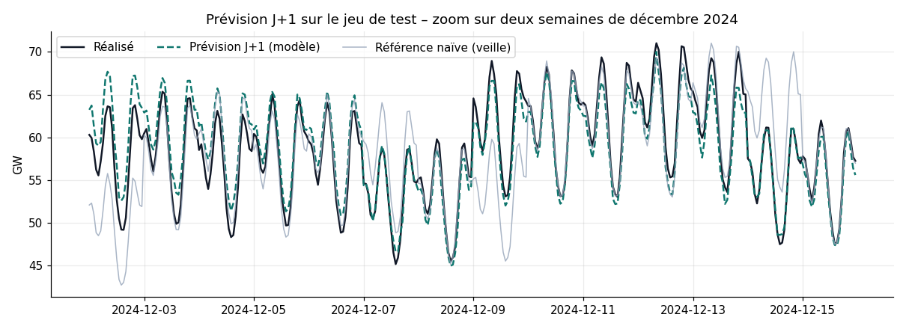
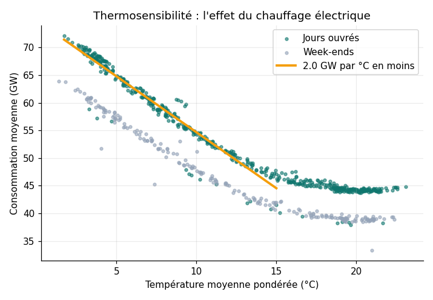
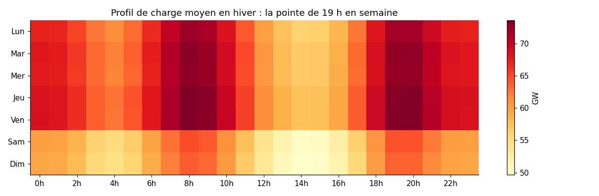
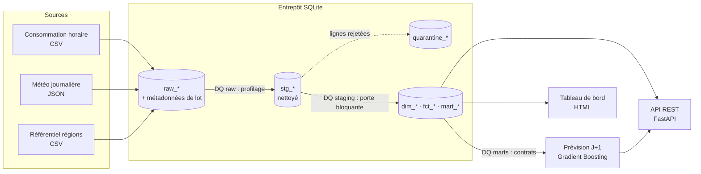

# ⚡ Energy Data Platform

[](https://github.com/Khadija-ibisk/energy-data-platform/actions/workflows/ci.yml)


**Plateforme de données de bout en bout sur la consommation électrique des 12 régions de France métropolitaine.**
Elle ingère des sources hétérogènes, contrôle et met en quarantaine les données défectueuses, construit un entrepôt
en couches, prévoit la consommation du lendemain et expose le tout via une API REST et un tableau de bord.

> Les données sont simulées de façon réaliste (ordres de grandeur calés sur le système électrique français :
> ~445 TWh/an, pointe hivernale ~80 GW, thermosensibilité ~2 GW/°C) afin que le projet soit entièrement reproductible
> sans clé d'API.

---

## 📌 Résultats

| Indicateur | Valeur |
|---|---|
| Consommation 2024 | **449 TWh** |
| Pointe maximale | **79,9 GW** (23 janvier 2023, 19 h) |
| Thermosensibilité hivernale | **2,1 GW par °C** en moins |
| Prévision J+1 (nov.-déc. 2024) | **2,2 % d'erreur (MAPE)**, soit **61 % de mieux** que la référence naïve |
| Qualité des données | 18 contrôles automatisés, 95 lignes mises en quarantaine, 0 trou dans les marts publiés |



| Thermosensibilité | Profil de charge en hiver |
|---|---|
|  |  |

## 🏗️ Architecture



L'ensemble est piloté par un **orchestrateur maison** (DAG, tri topologique, reprises automatiques,
historique des exécutions) :

```
extract_sources → load_raw → dq_raw → build_staging → dq_staging → build_marts → dq_marts → train_forecast → build_report
```

## 🧩 Ce que montre ce projet

| Compétence | Mise en œuvre |
|---|---|
| **Ingestion multi-formats** | CSV + JSON, métadonnées de lot (`_batch_id`, `_ingested_at`), table `meta_ingestion` |
| **Qualité des données** | Framework déclaratif (`not_null`, `unique`, `range`, `accepted_values`, `relationship`, `completeness`, `custom`), sévérités `warn` / `error`, historisation dans `dq_results` |
| **Nettoyage** | Dédoublonnage (`ROW_NUMBER`), conversion °F → °C, imputation, détection de pics, **quarantaine** avec motif de rejet |
| **Modélisation** | Couches raw → staging → marts, dimensions, faits horaires et journaliers, calendrier généré par **CTE récursive** |
| **SQL avancé** | Fonctions de fenêtrage (`LAG`, `LEAD`, `RANK`), clause `WINDOW`, régression linéaire en SQL (thermosensibilité) |
| **Orchestration** | DAG avec dépendances, détection de cycles, reprises, journalisation, `meta_pipeline_runs` |
| **Machine Learning** | Prévision « day-ahead » sans fuite de données, comparaison à deux références naïves, importance par permutation |
| **API** | FastAPI, schémas Pydantic, validation des paramètres, codes 404 / 422 / 503, documentation OpenAPI |
| **Industrialisation** | 25 tests pytest, CI GitHub Actions, Docker et docker compose, Makefile |

## 🚀 Démarrage

```bash
git clone https://github.com/Khadija-ibisk/energy-data-platform.git
cd energy-data-platform
python -m venv .venv && source .venv/bin/activate   # Windows : .venv\Scripts\activate
pip install -r requirements.txt

PYTHONPATH=src python -m energy.pipeline           # pipeline complet (~30 s)
PYTHONPATH=src uvicorn energy.api.main:app         # API sur http://localhost:8000/docs
pytest -v                                          # 25 tests
```

Sous Windows (PowerShell), remplacez `PYTHONPATH=src` par `$env:PYTHONPATH="src";`.

Avec Docker :

```bash
docker compose up --build    # exécute le pipeline puis sert l'API sur le port 8000
```

## 🔌 API

| Méthode | Route | Description |
|---|---|---|
| GET | `/health` | État de l'entrepôt et du dernier run du pipeline |
| GET | `/regions` | Référentiel des régions |
| GET | `/regions/{code}/daily?start=&end=` | Consommation journalière d'une région |
| GET | `/kpis/regions?year=2024` | KPI annuels et thermosensibilité par région |
| GET | `/kpis/peaks` | Top 10 des heures de pointe |
| GET | `/forecast?day=2024-12-12` | Prévision horaire vs réalisé |
| GET | `/forecast/metrics` | Performances du modèle |
| GET | `/quality/latest` | Résultats des contrôles qualité du dernier run |

## 📁 Structure

```
energy-data-platform/
├── src/energy/
│   ├── ingestion/        # sources simulées + chargement raw
│   ├── quality/          # framework de contrôles qualité
│   ├── orchestration/    # DAG et exécution
│   ├── ml/               # prévision J+1
│   ├── api/              # API FastAPI
│   ├── reporting/        # tableau de bord HTML
│   ├── transform.py      # exécution des modèles SQL
│   └── pipeline.py       # définition du DAG + CLI
├── sql/
│   ├── staging/          # nettoyage et quarantaine
│   └── marts/            # dimensions, faits, marts analytiques
├── tests/                # 25 tests
├── docs/                 # dictionnaire de données
├── reports/              # tableau de bord et graphiques générés
├── Dockerfile · docker-compose.yml · Makefile
└── .github/workflows/ci.yml
```

## 📚 Documentation

- [Dictionnaire de données](docs/data_dictionary.md)
- [Tableau de bord](reports/dashboard.html) (à télécharger puis ouvrir dans un navigateur)

## 📄 Licence

MIT – voir [LICENSE](LICENSE).
